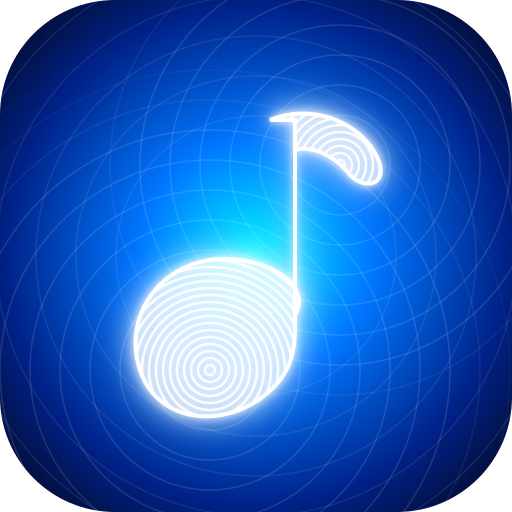

<div align="center">

  

  # Pulsr Music
  ### Premium Offline-First Audiophile Player for Android

  <p align="center">
    <strong>22-Stage Native C++ DSP • 10/32/64-Band EQ • 652 AutoEQ Profiles • DSD512 • 11 Player Themes • Pulsr Party • Quran Mode • Cast &amp; Remote Sources • Zero Telemetry</strong>
  </p>

  <p align="center">
    <a href="https://flutter.dev"></a>
    <a href="https://dart.dev"></a>
    <a href="#"></a>
    <a href="https://github.com/DevEslam1/pulsr/releases"></a>
    <a href="LICENSE"></a>
  </p>

  <p align="center">
    <a href="#-overview">Overview</a> •
    <a href="#-key-features">Features</a> •
    <a href="#-headphone-calibration--autoeq">AutoEQ</a> •
    <a href="#-architecture--tech-stack">Architecture</a> •
    <a href="#-getting-started--build-guide">Build</a> •
    <a href="#-privacy--permissions">Privacy</a> •
    <a href="#-known-limits">Limits</a>
  </p>

</div>

---

## 🌟 Overview

**Pulsr Music** is an offline-first audiophile player for Android, built with Flutter, Dart, BLoC and Drift SQLite. A native C++20 engine handles real-time DSP, while a small Go server powers synchronized group listening.

It combines a 22-stage DSP chain, bit-perfect USB-DAC output, 11 Now Playing themes, karaoke with live pitch tracking, an offline 114-surah Quran Mode, DLNA casting and SMB/WebDAV/FTP remote sources. The **Pure** build is provably offline: the INTERNET permission is removed at manifest level. The optional **Plus** build adds YouTube Music behind a compile-time flag.

> **Verification status (2026-11-20):** all §8 audio sections are code-complete and covered by host/unit/widget suites; device-only attestations (USB DSD/UAC2, multichannel DAC, Android FIR, Cast/UPnP receiver, ADC loopback, battery run) are still pending. No section is certified 10/10 without that hardware evidence.

> This README summarizes the shipped surface. For the source-verified count-by-count inventory, see [docs/FEATURE_MATRIX.md](docs/FEATURE_MATRIX.md). For the complete Section 8 remediation and audit results, see [docs/PROOF_PACK_2026-11-20.md](docs/PROOF_PACK_2026-11-20.md) and [docs/FINAL_AUDIT_2026-11-20.md](docs/FINAL_AUDIT_2026-11-20.md). Dated audit documents are snapshots, not current promises — see [docs/README.md](docs/README.md).

---

## 📊 At a Glance

| Area | Shipped capability |
|---|---|
| **DSP** | 22 native stages, 16 concurrent engines, 64-band parametric EQ, dedicated FIR stage, 8-band dynamic EQ, 4-band compressor, true-peak limiter, 9 reverb programs, crossfeed, saturation, bass management, 2–8 channel manager |
| **Hi-Res** | DSD64–DSD512 decode to 768 kHz PCM, dedicated pull-session native DSD, DoP carriers, SACD ISO extraction, USB-DAC exclusive output with UAC2 volume, AAudio direct, 32-bit float path |
| **Experience** | 11 Now Playing themes + Theme Studio, 8 visualizer styles + Milkdrop shader, karaoke pitch highway, synced lyrics, ambient mixer |
| **Library** | Reactive Drift SQLite index, 8 views, tag/artwork editor, 16-field smart playlists, duplicate cleanup, CUE sheets, 3 queue slots, 500-station radio store |
| **Network** | Optional YouTube Music, resumable chunked downloads, proxy/DoH, DLNA/UPnP casting, SMB/WebDAV/FTP sources |
| **Social** | Pulsr Party (Go WebSocket server, 2–10 members), Last.fm/ListenBrainz/Libre.fm/webhook scrobbling, Discord Rich Presence |
| **Privacy** | Pure build removes INTERNET at manifest level; no ads, analytics or accounts |
| **Locales** | English, Arabic (RTL) and Spanish, 3,082 messages each |

---

## 🌐 Landing Website

The static landing page lives in [`website/`](website/) and opens directly in any modern browser:

- Interactive player cockpit with spectrum visualizer, seekbar and Aura palette switching.
- 10/32/64-band EQ and AutoEQ sandbox with a live frequency-response curve.
- 22-stage DSP, 4,096-tap FIR, Remaster oversampling and HRTF/SOFA feature cards alongside the EQ and AutoEQ sandbox.
- Sections for **Pulsr Party**, **Quran Mode**, **Karaoke & Visuals**, and **Pro Audio / Chain of Custody**.
- DSP, themes, editions, library, integrations, comparison, downloads and FAQ.

```bash
# preview locally
npx serve website
```

---

## ✨ Key Features

### 🎧 1. Audio Engine & DSP

- **22-stage native C++ chain** with a bit-perfect fast path, lock-free render handoff and 16 concurrent engines. A governor degrades stages by real-time factor and thermal level instead of glitching.
- **Dedicated FIR Stage**: 100% wet per-headphone FIR correction stage (`STAGE_ARBITRARY_EQ`) separate from reverb, matching native PEQ within $\pm 0.1$ dB across 20 Hz – 20 kHz with automatic preamp headroom protection.
- **10 / 32 / 64-band EQ**: 10-band graphic, 32-band and 64-band parametric modes; eight biquad filter types; ±15 dB bands; per-band solo/mute; 4,096-tap arbitrary-response FIR EQ; 12 presets.
- **652 bundled AutoEQ profiles**: five-band compensation curves matched to the connected headphone by name, with online search, user imports and a computed preamp.
- **Dynamics**: 8-band dynamic EQ, 4-band multiband compressor with Linkwitz-Riley crossovers, 4× oversampled true-peak lookahead limiter, dynamic bass and ReplayGain.
- **Tone and space**: four crossfeed modes (BS2B, Chu Moy, Jan Meier, custom), 3-band stereo imager with bass mono, three harmonic-saturation models, loudness contour, sub crossover, and HRTF / SOFA spatializer with user-supplied SOFA/WAV HRIRs, inverse-distance interpolation, rate resampling and zero render-thread allocations (no HRIR dataset is bundled).
- **Convolution reverb**: nine programs from Studio 0.35 s to Cathedral 5.0 s, custom impulse responses up to 2,000,000 samples / 10 s, wet/dry, predelay and damping.
- **Voicing, Remaster and Scripting**: DAC Voicing (Sharp, Slow, Minimum-phase) with harmonic warmth; Remaster follow-rate upsampler (2×/4×/8×) with step-down (8-4-2-1); PCM-to-DSD sigma-delta engine (offline engine path only; not wired to a playback sink); ViPER-DDC `.vdc` profiles with up to 256 sections; LiveProg EEL/JSFX subset.
- **DSD and SACD**: Dedicated native USB DSD pull session (`NativeDsdSession`) without fake WAV timelines; DSD64–DSD512 to PCM up to 768 kHz; DoP carriers at 176.4/352.8/705.6 kHz; SACD ISO indexing and DSF extraction.
- **Playback extras**: gapless preload, linear/exponential crossfade, Automix BPM/key analysis (40–240 BPM), A-B loop, per-track delay, bookmarks, silence skip and sleep timer.
- **Ambient mixer**: nine loops (rain, fire, forest, ocean, wind, thunder, birds, café, white noise), up to four at once with independent volume.

### 🔌 2. Output, Bit-Perfect & Custody

- **`PlaybackBackend` & Derived Status Architecture**: Modular playback seam (`LocalPCM`, `LocalDSD`, `Cast`, `UPnP`) with a central backend contract and dynamic `OutputVerdict` derived from negotiated format and active stages. Status updates immediately mid-track and on route change.
- **Three output modes** in the vendored Media3 sink: `DEFAULT → FLOAT → AAUDIO`, with automatic fallback and re-prepare.
- **AAudio direct**: 16-bit, float32, 24-bit packed and API 31+ exclusive 32-bit; maximum two channels; 150 ms default target buffer.
- **USB-DAC exclusive & UAC2 standard volume**: UAC2 standard GET_CUR `0x81` / SET_CUR `0x01` compliance with hardware volume attenuation readback. Volume keys move the DAC attenuator only during active hardware-volume playback.
- **True Low-Power Mode**: Distinct Battery Saver (degraded DSP complexity) and Low-Power Bypass (complete DSP thread bypass) modes, guarded by a derived `dspActive` interlock that is cleared on engine release and refuses bypass while DSP/remaster/HRTF are active; per-stage mAh/h telemetry (`stagePowerSpecs`) includes remaster and HRTF. Native DSD and USB-exclusive endpoints are not bypassed.
- **32-bit float DSP path** with TPDF requantization when a 16-bit sink boundary is required.
- **Honest bit-perfect policy**:
  - Lossless sources are eligible: FLAC, WAV, AIFF, DSD/DSF/DFF and integer PCM. ALAC is eligible only when the device MediaCodec advertises `audio/alac`/`audio/x-alac`; no ALAC decoder is bundled. WavPack, APE and TTA are recognized by the policy but have no decoder in this build.
  - Lossy sources and live radio are blocked from a bit-perfect claim.
  - Ambiguous containers (`.m4a`, `.mp4`, `.ogg`, `.oga`, `.mka`, `.webm`) report `source_codec_unconfirmed` instead of pretending to be verified.
  - 32-bit float conversion reports `source_32bit_float_conversion_not_lossless`.
  - Bluetooth is blocked because it re-encodes.
- **Chain of custody**: 4,096 frames × 2 channels hashed at input and output, with an exportable JSON certificate. `bitExactMeasured` is only reported when the digests match.
- **Measurement Harness & Gates**: High-dynamic-range Kaiser window ($\beta=18.0$, $>150$ dB sidelobe suppression) FFT analysis, CCIF 19+20 kHz twin-tone IMD2/IMD3, identical-channel crosstalk detection, and a host-level proof dossier ([docs/PROOF_PACK_2026-11-20.md](docs/PROOF_PACK_2026-11-20.md)). Hardware loopback and device attestations remain pending.
- **Diagnostics**: 19 telemetry slots, xrun counters, thermal/RTF state, safe mode, self-test and a redacted support bundle.

### 💎 3. Aura Design & 11 Player Themes

Themes are real player surfaces, not colour swaps (`ThemeRegistry`):

1. **Classic Standard** — traditional high-density layout with ambient glow.
2. **Card Glass Overlay** — full-bleed artwork with frosted glass controls.
3. **Vinyl Circle** — centered circular artwork with a continuous spin.
4. **Minimalist Waveform** — spacious studio focus on the waveform.
5. **Vinyl Turntable Studio** — grooved record, center label and tonearm.
6. **CD Turntable** — iridescent disc with stylus and track index.
7. **Retro Cassette Deck** — spinning spools and magnetic tape.
8. **Full-Bleed Waveform** — audio-reactive waveform backdrop.
9. **Karaoke Lyrics Immersion** — full-screen synchronized lyrics.
10. **Clean Modern Flow** — borderless artwork, capsule slider and quick actions.
11. **Milkdrop Visualizer** — GPU shader visuals behind the artwork.

**Theme Studio** adds palette, corner radius and ambient glow controls, live preview and JSON export/import. AMOLED pure black, light and high-contrast modes are included, plus a scheduled light/dark switch.

### 🎤 4. Lyrics, Karaoke & Visualizers

- LRC parsing with tap-to-seek lines, millisecond offset editor and an in-app lyrics editor.
- LRCLIB lookup when local lyrics are missing.
- Online translation and romanization into the app's current language.
- Shareable lyric cards.
- **Karaoke mode**: YIN live pitch detection, pitch highway, ±12 semitone shift, per-line practice loop and a 0–100 score with session average.
- **Eight visualizer styles + Off**: Frequency Bars, Smooth Wave, Radial Pulse, Ambient Particles, 3D Terrain, Album-Art Reactive, Custom JSON and Milkdrop.
- Milkdrop runs `shaders/milkdrop.frag` on the GPU and falls back to a Canvas painter under GPU Saver; `.milk` and `.json` presets can be imported.
- Animated canvas artwork from Apple Music, Tidal and community sources where available.

### 📚 5. Library & Organisation

- Reactive Drift SQLite database with eight views: Songs, Downloaded, Albums, Artists, Favorites, Folders, Genres and Years.
- Folder tree and flat folder browser, hidden-folder exclusions and `.nomedia` compliance.
- **Tag & artwork editor**: title, artist, album, genre, year, track/disc number, comment and embedded artwork; multi-select batch editing with checkpoint/retry and undo; online metadata matching.
- **Smart playlists**: 16 fields × 8 operators, match-all/any, limits, live preview and seeded presets.
- **Duplicate finder**: metadata/duration passes followed by content checksum verification; keep-best, bulk delete and reclaimable-bytes estimate.
- **Missing artwork backfill** via the iTunes Search API with rate limiting and exponential backoff.
- **Library statistics**, artwork grid, favorites and recents.
- **Three persisted queue slots** (Q1/Q2/Q3) with drag reorder, add-next/add-last and save-as-playlist.
- **CUE sheet playback**: a single-file album image with a sibling `.cue` expands into virtual tracks with correct boundaries.
- **Internet radio**: 40 curated stations imported on demand, 500-station user cap, live radio-browser search across three mirrors and M3U import.
- **Remote sources**: WebDAV, FTP and SMB (SMB on Android) with byte-range reads, local cache index, local HTTP stream server and a 100-source cap.
- **DLNA/UPnP casting**: SSDP discovery, AVTransport play/pause/seek, position polling and a local media HTTP server. Google Cast discovery runs over mDNS.

### 🕌 6. Quran Mode

- All 114 surahs of **Tanzil Uthmani 1.1** bundled offline (1.5 MB XML plus Dart mirror).
- Surah index, reading-only mode and a **Mushaf page reader**.
- Five reciter styles: Murattal, Mujawwad, Tarawih, Memorization and Sleep.
- **Hifz blind recall** (tap to reveal) and ayah repeat (single or range).
- Tempo at 0.5×, 0.75× and 1.0× with mosque ambience reverb and vocal warmth.
- Bookmarks, resume prompts and recitation auto-detection that survives restarts.

### 🎉 7. Pulsr Party

- Go WebSocket server in [`server/pulsr_party/`](server/pulsr_party/) with protocol v1: 13 frame types and 15 control actions (12 host-gated).
- Six-character room codes, nickname join, host promotion, kick and a 2–10 member room (default 5).
- Monotonic server clock plus an NTP-style client offset built from a 12-sample window; minimum-RTT sample wins, 120 s TTL and a 10 s ping loop.
- Host-only or democratic queue; the autoplay supplier survives a host leaving.
- Host speaker-delay alignment and seek/watch deadbands.
- Self-hostable; the default endpoint is user-overridable.

### 📱 8. Android Integration & Tools

- **Home-screen widget**: five layouts and nine actions (play/pause, prev/next, favorite, shuffle, repeat, queue, open, main).
- **Quick Settings** playback tile and a search-suggestions provider.
- MediaSession, lock-screen controls and a foreground media playback service.
- File intents: `VIEW`, `SEND`, `SEND_MULTIPLE`, `MUSIC_PLAYER` and `MEDIA_PLAY_FROM_SEARCH`.
- **Assistant bridge**: four launcher shortcuts and five resolver intents (play playlist, resume album, shuffle favorites, artist radio, search).
- **Command palette** with 27 commands and 13 keyboard shortcuts on desktop/tablet shells.
- **Spoken announcements** via Android TTS with delay, volume, ducking, cast and bit-perfect gates.
- **System behaviour**: audio focus, USB release policy, background USB close, volume-rocker track switch, linear/log volume and fade-out on pause.
- **USB ergonomics**: per-DAC VID/PID quirk profile, settle silence, force 16-bit, alt-setting reset, HID claim and transfer size.
- **Diagnostics**: device/output summary, DSP stage list, xrun counters, safe mode, self-test and a redacted `bundle.json` / `bundle.log` export.
- **Audio profiles**: capture, apply, share and import complete DSP snapshots with ten rolling backups.
- In-app update check against GitHub Releases.

### 🛡️ 9. Privacy, Editions & Online

- **Pulsr Pure** (`prod` flavor) removes `INTERNET`, `ACCESS_NETWORK_STATE`, `ACCESS_LOCAL_NETWORK` and `FOREGROUND_SERVICE_DATA_SYNC` at manifest level, and excludes Firebase, Sentry, the download service and YouTube code.
- **Pulsr Plus** (`dev` / `ytm` flavors, `ENABLE_YTM=true`) optionally adds YouTube Music search, browse, streaming and downloads.
- **YTM stack**: InnerTube `WEB_REMIX` search; Rhino signature and `n`-transform solving with cached rules; PoToken and visitor tokens; `signatureTimestamp`; authenticated `WEB` fallback for age-restricted tracks; geo/egress classification and per-signal circuit breakers.
- **Downloads**: three concurrent downloads, four-way chunked fetch, Range resume, 403 re-resolution, cancel tokens and a foreground service. Quality tiers: 256 / 128 / 64 kbps.
- **Network control**: HTTP/SOCKS5 proxy pool, DNS-over-HTTPS, cellular failover, Wi-Fi-only and offline-only modes.
- **SponsorBlock**: six categories, per-category toggles and a 256-entry LRU cache.
- **Pure is not a mode** — it is a separate build with no network permission to fall back on.

### 🔄 10. Sync, Integrations & Localization

- **Scrobbling** to Last.fm, ListenBrainz, Libre.fm and a custom webhook, with secure credential storage, offline queue replay and a stats screen.
- **Discord Rich Presence** through a built-in Gateway v9 client.
- **Optional cloud backup** to Firestore plus local JSON export/import. Firestore is hard-off in Pure builds.
- **Device profiles** and four automation triggers: Bluetooth connected, headphones plugged, USB DAC connected and charging.
- **Hearing safety**: seven-day sound dose based on EN 62368-1 / WHO-ITU H.870, four budgets and a −6 dB native ceiling.
- **Bluetooth latency calibration**: tap test plus round-trip probe blended with a ten-codec table, clamped to 0–500 ms.
- **Theme scheduler**, gesture remapping, experience mode and a 3-source dynamic palette.
- **Localized** in English, Arabic (RTL) and Spanish — 3,082 messages per locale.

---

## 🎧 Headphone Calibration & AutoEQ

Pulsr ships **652 five-band compensation profiles** in `assets/eq_profiles/headphone_profiles.json`.

How it behaves:

- Matches the connected headphone by normalized device name and applies the profile with a computed preamp.
- Supports a manual profile search, per-song auto-apply and user-imported profiles.
- Can be stacked with a separately measured room-correction curve.
- Is independent of ViPER-DDC `.vdc` device correction, which is a separate processor.

Typical profile families include Harman in-ear/over-ear targets, TWS earbuds, over-ear ANC headphones, open-back reference models, studio monitors and bass/studio presets. Exact model coverage is whatever the bundled JSON contains; the app does not claim a fixed number beyond **652**.

---

## 🏗️ Architecture & Tech Stack

Pulsr follows Clean Architecture with a feature-first presentation layer and a native real-time audio core.

```text
Presentation (Flutter)
  GoRouter · AppShell · Now Playing (11 themes) · Cubits/Freezed
        │
Domain
  Entities · use cases · repository interfaces · SmartAudioPlan · bit-perfect policy
        │
Data
  Drift SQLite · MusicRepository · MediaScanner · PulsrAudioHandler ·
  DownloadRepository · collaborative audio controllers
        │
        ├── Native C++20 DSP engine (android/app/src/main/cpp)
        │     AAudioSink · UsbAudioSink · 22-stage AudioDspEngine ·
        │     EQ / dynamics / reverb / DSD / custody
        │
        └── Go party server (server/pulsr_party)
              WebSocket hub · rooms · monotonic clock · protocol v1
```

### Tech stack

| Layer | Technology |
|---|---|
| UI | Flutter 3.47+, Dart 3.13+ (`material_ui`/`cupertino_ui` require `^3.13.0`), Material 3 |
| State | `flutter_bloc` Cubits, `freezed` immutable states, `fpdart` results |
| DI | `get_it` + `injectable` |
| Persistence | `drift` SQLite, `shared_preferences`, `flutter_secure_storage` |
| Audio | Vendored `just_audio` fork with `PulsrAudioSink`, `AAudioAudioSink`, `FloatDspAudioSink`, `NativeDspAudioProcessor`; `audio_service`; `audio_session` |
| DSP | C++20 + CMake/NDK, JNI bridges, per-stage native processors |
| Party | Go 1.22+, WebSockets, monotonic clock, hub/party/protocol packages |
| Media scanning | `on_audio_query` plus a direct file scanner |
| Routing | `go_router` |
| Codegen | `build_runner`, `freezed`, `drift_dev` |
| Online | Kotlin InnerTube client, Rhino JS engine, PoToken WebView, NewPipeExtractor fallback |

---

## 📁 Project Structure

```text
pulsr/
├── android/
│   └── app/src/main/
│       ├── cpp/                 # C++20 DSP engine (22 stages, AAudio, USB, DSD, EQ, reverb)
│       └── kotlin/              # MethodChannel plugins (USB, visualizer, widgets, TTS, SMB)
├── assets/
│   ├── app_icon/
│   ├── eq_profiles/             # 652 bundled AutoEQ profiles
│   ├── quran/                   # Tanzil Uthmani 1.1 text
│   └── sounds/                  # ambient loops
├── docs/
│   ├── adr/                     # 16 Architecture Decision Records
│   ├── gaps/                    # gap-closure handoffs and status
│   ├── qa/                      # device validation checklist
│   ├── FEATURE_MATRIX.md        # current source-verified capability list
│   └── README.md                # documentation index
├── lib/
│   ├── core/                    # DI, router, theme, services, network, widgets
│   ├── data/                    # Drift DB, audio pipeline, scanner, repositories
│   ├── domain/                  # entities, interfaces, use cases, bit-perfect policy
│   ├── features/                # 37 feature modules (player, library, party, quran, tools...)
│   ├── l10n/                    # EN / ES / AR ARB files and generated code
│   └── main.dart
├── scripts/                     # native DSP tests, audio smoke tests, flavor checks
├── server/pulsr_party/          # Go WebSocket party server
├── shaders/milkdrop.frag        # GPU visualizer shader
├── test/                        # 833 Dart test files
├── third_party/just_audio/      # vendored sink fork with native PCM hook
├── website/                     # landing page
└── pubspec.yaml
```

---

## 📚 Documentation

| Document | Purpose |
|---|---|
| [`docs/FEATURE_MATRIX.md`](docs/FEATURE_MATRIX.md) | Source-verified capabilities, counts and explicit limitations |
| [`docs/README.md`](docs/README.md) | Index of living references, dated audits and gap handoffs |
| [`docs/adr/`](docs/adr/) | 16 Architecture Decision Records (001–015, two 007s) |
| [`docs/player_architecture.md`](docs/player_architecture.md) | Volume authority, interruption manager and player hardening |
| [`docs/NATIVE_AUDIO_MATRIX.md`](docs/NATIVE_AUDIO_MATRIX.md) | Native host test matrix (DSD512, channel manager, DoP) |
| [`docs/gaps/README.md`](docs/gaps/README.md) | Gap-closure status versus USB Audio Player PRO |
| [`docs/qa/dsp-device-validation.md`](docs/qa/dsp-device-validation.md) | Manual device validation checklist |
| [`DESIGN.md`](DESIGN.md) | Design system source of truth |
| [`DESIGN_SYSTEM.md`](DESIGN_SYSTEM.md) | Palette, typography, player chrome and theme inventory |
| [`RUNBOOK.md`](RUNBOOK.md) | YTM latency runbook and verification gates |
| [`CLAUDE.md`](CLAUDE.md) | Codebase and architecture guide for AI agents |

Date-stamped documents under `docs/` are audit snapshots. They are intentionally not rewritten; see the labels in [`docs/README.md`](docs/README.md).

---

## 🏆 Quality Gates

Pulsr keeps a strict static-analysis and test baseline. Run the gates from the repository root:

```bash
flutter analyze
flutter test
dart format --set-exit-if-changed lib test
```

Additional suites:

| Gate | Command | Notes |
|---|---|---|
| Native DSP host suite | `./scripts/run_native_dsp_tests.sh` | DSD512, channel manager, DoP, limiter, stress; see `docs/NATIVE_AUDIO_MATRIX.md` for the current 48/48 result |
| Audio bridge smoke | `scripts/run_audio_bridge_smoke.ps1` | Windows host harnesses for JNI and sink transitions |
| Playback smoke | `scripts/run_audio_playback_smoke.ps1` | Cold-start local playback, progress, pause and resume |
| Party server | `cd server/pulsr_party && go test ./...` | Go unit tests |
| Production isolation | `python scripts/check_prod_flavor.py` | Verifies the Pure build excludes online code |

The repository contains **833 Dart test files** across unit, cubit, fuzz, property, performance, accessibility, concurrency and security suites. Test counts are intentionally not hardcoded in CI output here because they change as features land.

---

## 🚀 Getting Started & Build Guide

### Prerequisites

- Flutter `>= 3.47.0` — this is the binding constraint (`material_ui` 1.11.x and `cupertino_ui` 1.1.x both require it, and Flutter 3.47 ships Dart 3.13).
- Dart: the runtime floor is 3.13 via the Flutter constraint above. `environment.sdk` deliberately keeps the `>=3.0.0` lower bound, because that value selects the package *language version*; raising it to `^3.13.0` would move the whole repo to the Dart 3.7+ tall formatter and surface ~344 currently-gated lint diagnostics (separate migration). Vendored `third_party/just_audio` only needs `^3.6.0`, so it is not the binding constraint.
- Android Studio with Android SDK and NDK.
- JDK 17.
- Go 1.22+ only if you want to run the party server.

### 1. Clone and install

```bash
git clone https://github.com/DevEslam1/pulsr.git
cd pulsr
flutter pub get
```

### 2. Generate code

```bash
dart run build_runner build --delete-conflicting-outputs
```

### 3. Run

Connect an Android device or emulator with USB debugging:

```bash
flutter run
```

### 4. Test

```bash
flutter analyze
flutter test
```

Native host tests (bash / Git Bash):

```bash
./scripts/run_native_dsp_tests.sh
```

### 5. Build release artifacts

> Production builds should pass `--dart-define=ENV=prod`. Sentry initializes only when `SENTRY_DSN` is supplied; omit it for a build without crash reporting. The Gradle `prod` flavor does not set the Dart environment by itself.

```bash
# Universal APK
flutter build apk --flavor prod --release --dart-define=ENV=prod

# Split per ABI
flutter build apk --flavor prod --release --split-per-abi --dart-define=ENV=prod

# Play Store bundle
flutter build appbundle --flavor prod --release --dart-define=ENV=prod
```

For the optional online build, use the `dev` or `ytm` flavor and `--dart-define=ENABLE_YTM=true`.

### 6. Run the party server locally

```bash
cd server/pulsr_party
go run main.go
```

---

## 🔒 Privacy & Permissions

| Permission | Android level | Category | Usage |
|---|---|---|---|
| `READ_MEDIA_AUDIO` | API 33+ | Storage | Discover and index local audio |
| `READ_EXTERNAL_STORAGE` | API ≤ 32 | Storage | Read audio on older devices |
| `WRITE_EXTERNAL_STORAGE` | API ≤ 29 | Storage | Save edited tags or exported artwork |
| `FOREGROUND_SERVICE` | API 28+ | Playback | Continue audio while the screen is locked |
| `FOREGROUND_SERVICE_MEDIA_PLAYBACK` | API 34+ | Playback | Media playback service type |
| `FOREGROUND_SERVICE_DATA_SYNC` | API 34+ | Downloads | Keep YTM downloads alive; removed in Pure |
| `POST_NOTIFICATIONS` | API 33+ | Notifications | MediaStyle controls and progress |
| `RECORD_AUDIO` | All | Optional | Room-correction sweep capture and visualizer taps; optional |
| `MODIFY_AUDIO_SETTINGS` | All | Playback | Equalizer and audio session configuration |
| `WRITE_SETTINGS` | All | Optional | Set a track as the system ringtone; user-initiated |
| `WAKE_LOCK` | All | Playback | Prevent CPU sleep during playback |
| `ACCESS_NETWORK_STATE` | All | Network | Connectivity state; removed in Pure |
| `ACCESS_WIFI_STATE` | All | Network | Wi-Fi-only download policy; removed in Pure |
| `ACCESS_LOCAL_NETWORK` | All | Network | DLNA discovery, SMB/WebDAV/FTP, local stream servers; removed in Pure |
| `INTERNET` | All | Network | Optional YTM, metadata, scrobbling and cloud sync; removed in Pure |
| `BLUETOOTH_CONNECT` / `BLUETOOTH` | API 31+ / ≤ 30 | Playback | Device names and codec information |
| `com.pulsr.music.permission.WIDGET_CONTROL` | App-defined | Widget | Allow widget buttons to control playback |

USB host support is declared as an optional feature (`android.hardware.usb.host`), not a required permission.

---

## ⚠️ Known Limits

These are deliberate, source-verified limits — not roadmap promises:

- **Bit-perfect is USB-DAC only.** Bluetooth is blocked because it re-encodes; lossy sources are blocked from a bit-perfect claim; ambiguous containers report `unverified`.
- **AAudio is stereo-only.** More than two channels, non-default speed/pitch or silence skip suspend AAudio back to AudioTrack.
- **Android system EQ/LoudnessEnhancer do not affect AAudio.** They are bound to the AudioTrack session.
- **Sinc playback resampling is not user-enableable.** `hasSincResampler = false`; enabling returns `DSP_UNSUPPORTED`. Rate conversion happens in the tap-side SRC and the platform.
- **The spatial panner is balance/mono**; HRTF is a separate `STAGE_HRTF` binaural stage with user-supplied SOFA/WAV HRIRs, not a platform spatializer claim.
- **The native UAC2 sink is experimental** and marked as not validated against every DAC in source.
- **APE, WMA, TTA, TAK, WavPack, MPC, MOD, IT, XM and S3M are recognized but not decodable** in this build. SACD ISO is supported through extraction to DSF. ALAC playback depends on the device MediaCodec; no ALAC decoder is bundled.
- **PCM→DSD is an offline engine path only**; it is not wired to a playback sink in this build.
- **HRTF has no bundled HRIR dataset**; load a SOFA or WAV HRIR from the player EQ spatial tab.
- **MQA is core unfold only**; no authenticated render is claimed.
- **Blind ABX ships** in the player with live native bypass, automatic level matching and redacted JSON export. Measurement/FFT hardware provenance remains a CLI gate.
- **Desktop and iOS are not shipped.** Their directories contain stock Flutter runners; all native integrations are Android.
- **Pulsr Party needs a server.** The default endpoint is overridable and the Go server is self-hostable; room size is 2–10, default 5.

---

## 🌍 Localization

- 🇺🇸 English (`en`) — template locale.
- 🇸🇦 Arabic (`ar`) — full RTL layout.
- 🇪🇸 Spanish (`es`).

Each locale carries 3,082 messages, with an in-app language switcher.

---

## 📄 License

This project is free software licensed under the **[GNU General Public License v3.0](LICENSE)**.

```text
Copyright (C) 2026 Pulsr Music Contributors.

This program is free software: you can redistribute it and/or modify
it under the terms of the GNU General Public License as published by
the Free Software Foundation, either version 3 of the License, or
(at your option) any later version.

This program is distributed in the hope that it will be useful,
but WITHOUT ANY WARRANTY; without even the implied warranty of
MERCHANTABILITY or FITNESS FOR A PARTICULAR PURPOSE.  See the
GNU General Public License for more details.

You should have received a copy of the GNU General Public License
along with this program.  If not, see <https://www.gnu.org/licenses/>.
```

> **Why GPLv3?** The optional YouTube Music integration links NewPipeExtractor, which is GPLv3. The combined work is therefore GPLv3, and the extraction bridge is excluded from the Pure build.

---

<div align="center">
  <sub>Crafted with passion for pure sound and design perfection.</sub>
</div>
